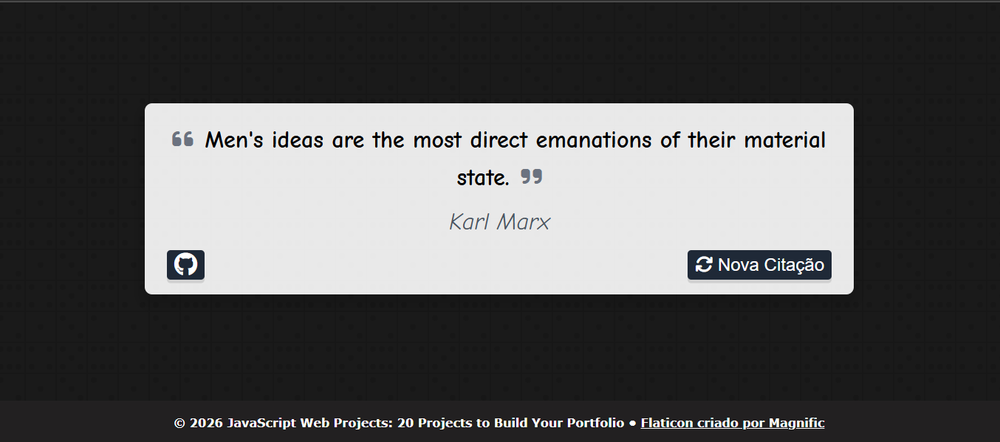

# quote-generator

Gerador de citações - Uma página simples que exibe citações aleatórias e seus autores cujos dados são carregados de uma 
(API externa)[https://jacintodesign.github.io/quotes-api/data/quotes.json].

## Funcionalidades
- Exibe uma citação aleatória ao abrir a página.
- Permite carregar outra citação pelo botão **Nova Citação**.
- Apresenta um botão para acessar o GitHub do autor.

## Tecnologias
HTML, CSS e JavaScript.
